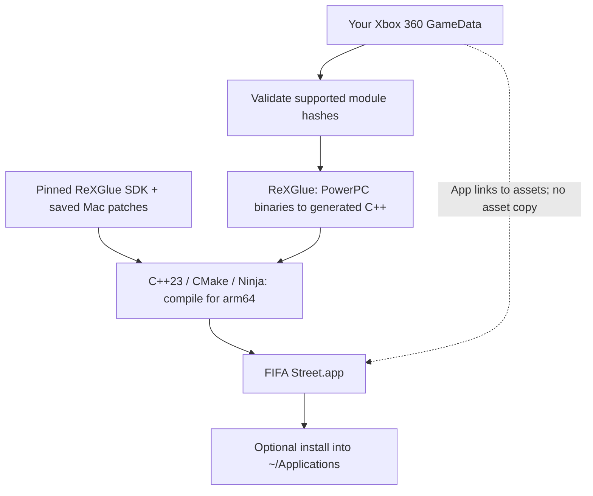
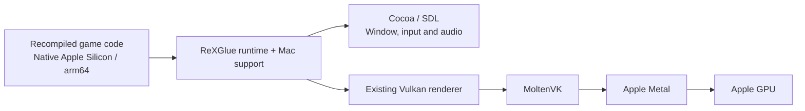

<div align="center">


# ReStreet for macOS

**FIFA Street (2012), running natively on Apple Silicon.**

A source-build Mac port by **[fyzanshaik](https://github.com/fyzanshaik)**, built on
**[SamuelitoDaVila's ReStreet](https://github.com/samuelit0davila/fifa-street-pc-port)**.

[Get started](#get-started) · [Architecture](#how-it-works) · [Controls](#keyboard-controls) · [Performance](#performance-and-fixes) · [Engineering log](LOG/PROGRESS.md)

</div>

This fork adds macOS support to the original Windows project. It recompiles
supported Xbox 360 game binaries into native **arm64** code using ReXGlue and
reuses the existing **Vulkan renderer**, with **MoltenVK translating Vulkan calls
to Apple's Metal API**. It also adds the Mac build, runtime fixes, app packaging,
keyboard profile and diagnostics needed to play and develop on a Mac.

The long-term goal is **agentic game benchmarks**: human versus AI and AI versus
AI, with repeatable observations, actions and evaluation results. A usable,
reproducible Mac game is the foundation.

## Status

| Area | Current state |
|---|---|
| Apple Silicon | Native build; boot, menus and playable matches manually checked |
| Gameplay and audio | Latest feedback reports good gameplay and improved music/menu response |
| Distribution | Source-build preview; no downloadable Mac game binary |
| Performance | About 25 distinct displayed outputs/sec in late main-menu diagnostics; sustained 60 FPS unverified |
| Intel Macs | Untested |
| AI benchmarks | Experimental capture/controller seams exist; model integration and end-to-end evaluations are future work |

Tested on an **Apple M5 MacBook, 16 GB RAM, macOS 26.6.2**. Save/reload, every
mode, multiple controllers and live resizing are not fully validated. See the
[validation status](docs/STATUS.md) and [engineering log](LOG/PROGRESS.md) for
what was measured and what remains open.

## Get started

### 1. Prepare your Mac and game data

You need:

- An **Apple Silicon Mac**.
- Xcode command line tools with **AppleClang 16+**, or LLVM Clang 18+, for C++23.
- **CMake, Ninja and Python 3.9+**.
- Your own extracted **FIFA Street (2012) Xbox 360 `GameData`**, matching the
  [supported module revision](scripts/supported-macos-inputs.json).

Game assets and original executables are not included. This repository contains
the port's host code, runtime patches and build tools, rather than original EA
source code. The build validates your module hashes before compilation.

### 2. Clone, check and build

```sh
git clone --branch main https://github.com/fyzanshaik/fifa-street-pc-port.git
cd fifa-street-pc-port
brew install cmake ninja

# Check tools and game inputs before compiling.
./scripts/build-macos.sh --gamedata "/absolute/path/to/GameData" --check-only

# Build and package the Mac app.
./scripts/build-macos.sh --gamedata "/absolute/path/to/GameData" --jobs 2
```

Install Python with `brew install python` if `python3` is missing. The build
prepares the pinned SDK and bundled Vulkan/MoltenVK dependencies; no separate
Homebrew Vulkan installation is needed. The first build takes time. Subsequent
builds reuse the SDK and generated code.

### 3. Play or install

Run the built app:

```sh
./scripts/play-macos.sh
```

Or install it into `~/Applications` for Finder access:

```sh
./scripts/install-macos.sh
```

The output is `build/macos/out/FIFA Street.app`. Installation copies the app
without copying game assets; **keep your original `GameData` folder in place**,
because the app links to it. An existing installation is replaced only with
`--force`. Normal play has **no time limit**.

For toolchain help, rebuild options and packaging details, use the
[Mac setup guide](docs/BUILDING-MACOS.md).

## Watch live session logs

From the repository, start the viewer in **Terminal 1**:

```sh
./scripts/logs-macos.sh
```

Launch the installed app in **Terminal 2**:

```sh
./scripts/play-macos.sh "$HOME/Applications/FIFA Street.app"
```

The viewer can start before or after the game. It prints the latest session's
last 20 lines, follows new lines and automatically switches on subsequent
launches. **Ctrl+C stops only the viewer.** Each normal-play session is retained
under `build/macos/logs/play/<UTC>/fifastreet.log`.

Finder launches use separate logs inside the app bundle. Direct driver messages
such as MoltenVK notices remain in the launch Terminal. See
[log options and locations](docs/BUILDING-MACOS.md#logs-and-troubleshooting) to
pin a session or change the history length.

## How it works

### Build: original binaries to a native Mac app

ReXGlue's recompilation technology comes from the upstream projects. This fork
adapts the build and runtime for macOS and saves those changes as reproducible
patches.



Generated game code, the local SDK checkout and build products are not committed.
The app still needs your original game data at runtime.

### Runtime: native CPU code, Vulkan graphics through Metal

The existing Vulkan renderer is reused; it is not replaced by a new Metal
renderer. MoltenVK supplies the graphics compatibility layer.



## Keyboard controls

For a first match: **arrows** move, **E** sprints, **Space** passes and **D**
shoots. Xbox button prompts remain visible in the game.

| Key | Default action / Xbox input |
|---|---|
| Arrow keys | Player movement or menu selection / left stick |
| Space | Confirm or ground pass / A |
| D or Backspace (Mac Delete) | Back in menus or shoot / B |
| A | Lob pass or manual tackle / X |
| S | Through pass; hold to rush goalkeeper / Y |
| E / Q | Sprint / RT; Street Ball Control or defensive jockey / LT |
| W / R | Flair modifier or switch defender / LB; flick ball up / RB |
| I / J / K / L | Skill-stick up / left / down / right |
| Enter | Start or pause |

Close the window to exit, or hold **Enter** and press **D** for the host exit
prompt; **Space** confirms. The [full controls guide](docs/CONTROLS-MACOS.md)
covers stick clicks, tactics and customization. Actions follow the default
layout in [EA's Xbox 360 manual](https://eaassets-a.akamaihd.net/eahelp/manuals/fifa-street-manuals_Microsoft%20XBOX360.pdf);
custom in-game controller layouts can change them.

## Performance and fixes

The port initially had build/boot failures, black screens, severe menu delays
and broken-sounding audio. The main improvements were:

| Fix | Effect |
|---|---|
| Mac loading, startup ordering and PowerPC memory barriers | Correct native startup and guest synchronization |
| Precise idle waits | Idle audio-worker CPU fell from about 100% to 1% of one core in the runtime fixture |
| Dormant overlays and host presentation | Removed unnecessary redraws and reduced graphics queue contention |
| Shader-cache reload on Darwin | Reused persisted pipelines instead of resetting caches each launch |
| Anchored guest clock | Preserved fractional ticks and removed a shared mutex from frequent clock reads |
| Build, packaging and controls | Reproducible app builds, installation, arrow-key input and session logs |

Selected recorded results:

| Measurement | Before | After |
|---|---:|---:|
| Repeated host presentations, overlay comparison | 20,101 | 2 |
| Accumulated queue-acquisition wall time, overlay comparison | 72.600 s | 0.145 s |
| Guest clock / host rate, one-reader fixture | 0.960726 | Approximately 1.0 |

The latest late main-menu sample measured **24.565 new displayed outputs/sec**
with **zero backend-inserted audio silence**. Host redraws can repeat a frame,
so this is not a simulation-FPS measurement or proof of 60 FPS. Zero inserted
silence does not prove perfect physical playback. Comparisons span separate
runs with different screen/cache conditions; they are not a controlled match
benchmark.

Read the [measurement comparisons](LOG/PROGRESS.md#selected-comparable-measurements)
and [sanitized evidence](LOG/evidence/macos-measurements.json) for provenance,
failed experiments and limits. Further optimization is currently paused after
improved manual gameplay feedback.

## Future: agentic game benchmarks

The aim is to run human/AI and AI/AI matches, compare decision latency and game
outcomes, and make evaluations repeatable. Experimental frame capture and
virtual-controller seams provide a starting point.

The next work is to validate an observation/action loop, define reset and scoring
rules, then integrate decision APIs and run measured comparisons. **No model
integration, deterministic evaluation environment or end-to-end AI benchmark is
claimed today.**

## Documentation

| Guide | Purpose |
|---|---|
| [Mac setup](docs/BUILDING-MACOS.md) | Prerequisites, supported inputs, build, install and troubleshooting |
| [Controls](docs/CONTROLS-MACOS.md) | Keyboard reference and customization |
| [Validation status](docs/STATUS.md) | Verified behavior and remaining gaps |
| [Progress and diagnostics](LOG/PROGRESS.md) | Findings, measurements, failed approaches and lessons |
| [Agent instructions](AGENTS.md) | Workflow, validation and mistakes to avoid |

## Windows support

The original Windows installer, launcher and build path—including the Windows
v1.1 changes—are preserved. Use [upstream releases](https://github.com/samuelit0davila/fifa-street-pc-port/releases)
for Windows downloads and the [Windows build guide](docs/BUILDING.md) to compile
it. Those `.exe` downloads are not Mac installers.

Mac builds use a separate saved base patch from the version validated here.
Newer Windows SDK changes require separate Mac validation before adoption.

## Credits

- **[SamuelitoDaVila](https://github.com/samuelit0davila/fifa-street-pc-port)** — original ReStreet port, Windows installer and launcher.
- **[fyzanshaik](https://github.com/fyzanshaik)** — macOS fork, project direction, manual gameplay checks and agent-benchmark goal; development assisted by OpenAI Codex and OpenCode with DeepSeek.
- **Emran_Ahm3d** — upstream investigations into patch line endings, module registration, game-data paths, FootballCompEng boundaries and resource-compiler compatibility.
- **[ReXGlue](https://github.com/rexglue/rexglue-sdk)** and **[Xenia](https://github.com/xenia-project/xenia)** — recompilation and runtime foundations.
- **SDL, Vulkan, MoltenVK, LLVM, CMake, Ninja and other dependencies** — their respective authors and license notices.

## License and game content

Original project-authored code uses the [MIT License](LICENSE), with the existing
copyright notice retained. SDK patches and third-party components retain their
own licenses; see [third-party notices](licenses/README.md).

This repository does not include game assets, original Xbox executables,
generated game code or a Mac game binary. FIFA Street content, artwork and
trademarks belong to their respective owners. This is an unofficial community
project, unaffiliated with EA, Microsoft or Xbox.
